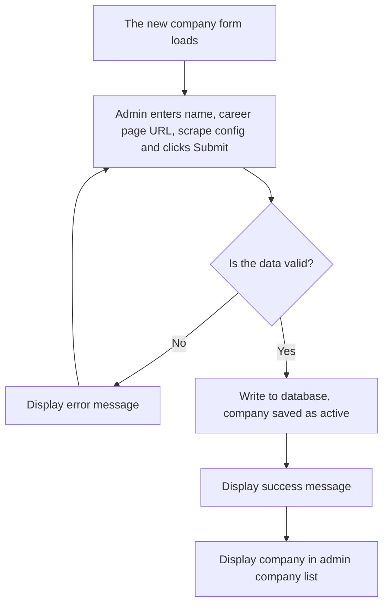
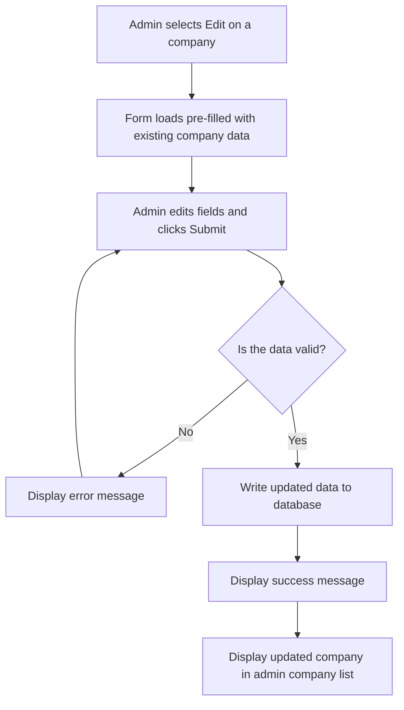
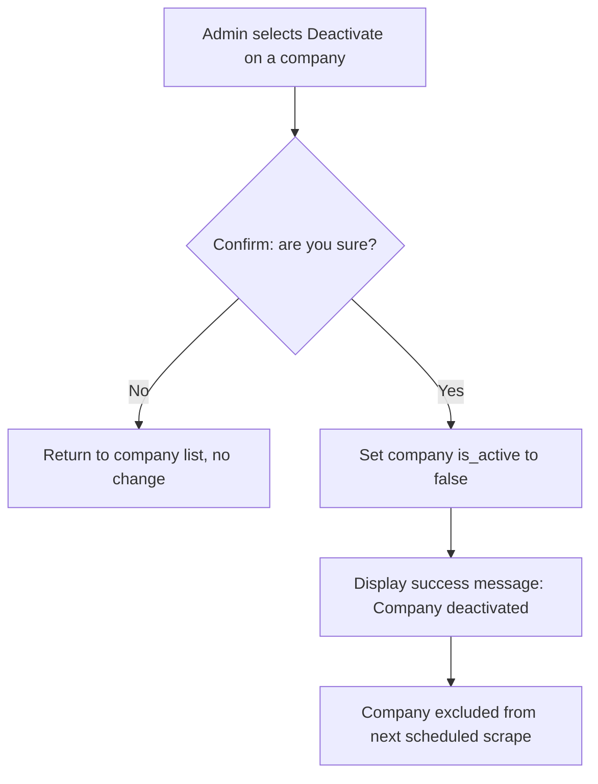
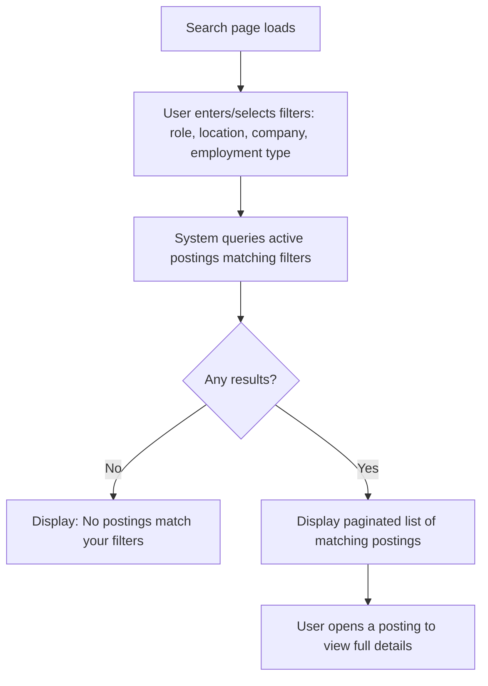
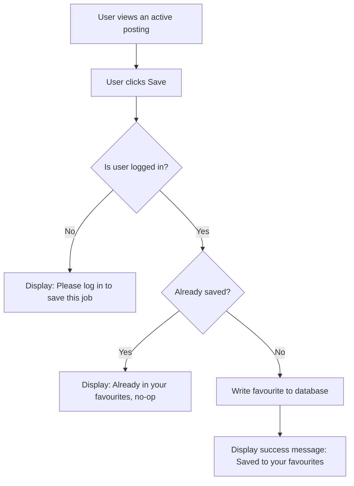
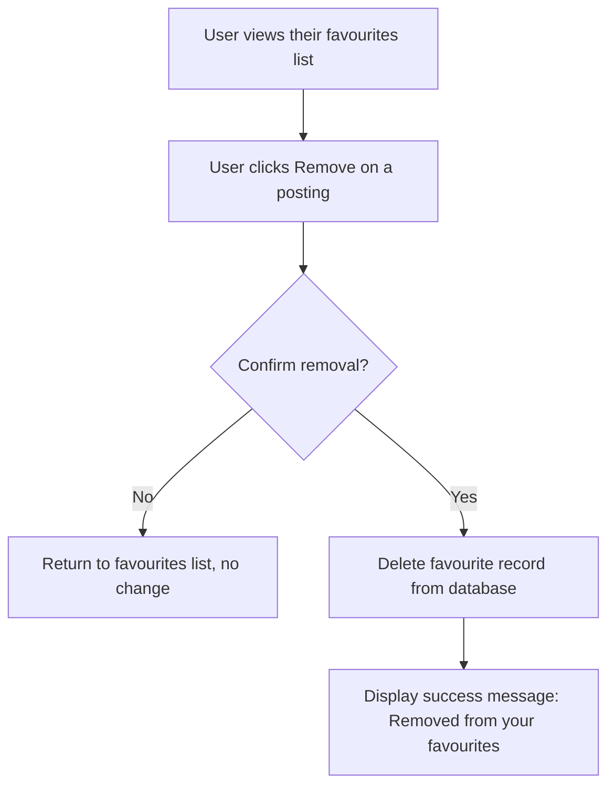
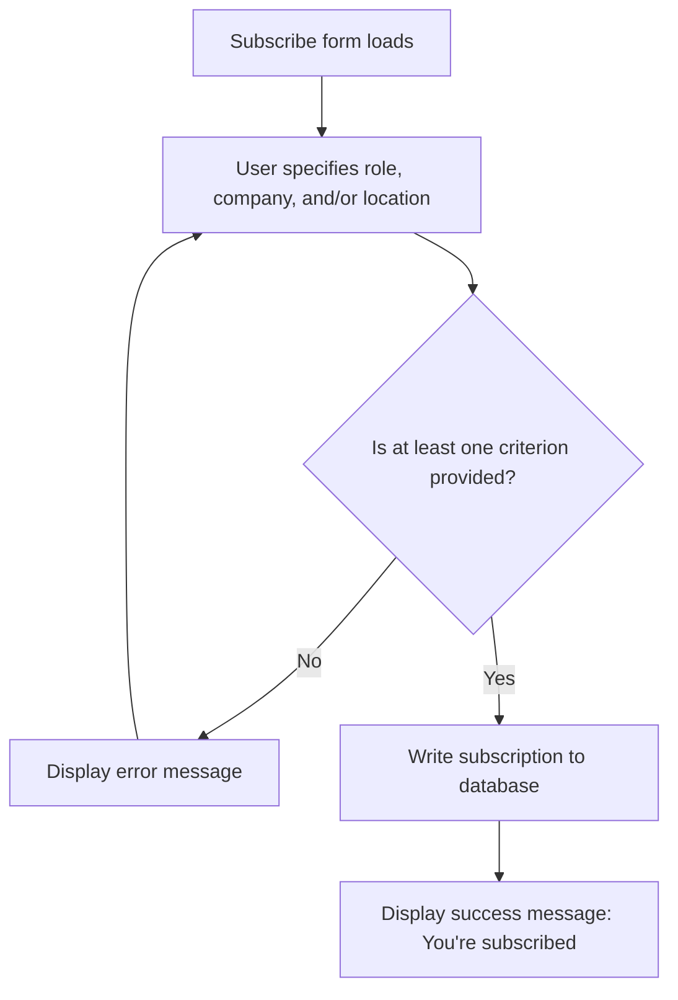
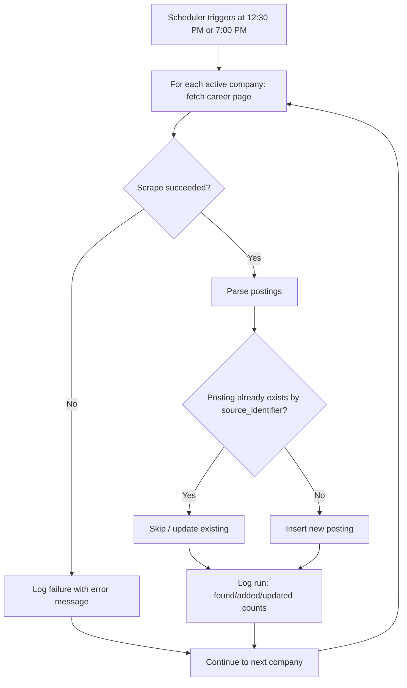
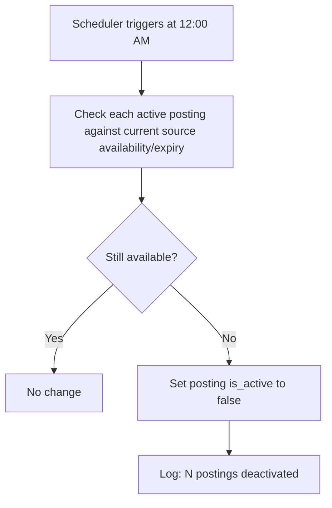

# Toronto Survival Jobs — Requirements Documentation

**Course:** HTTP 5310 — Capstone Project
**Instructors:** Bernie Monette & Adam & Sean Doyle
**Companion document:** Toronto Survival Jobs — Technical Documentation

---

## 1. Student Name
Rinzin
---

## 2. Project Name (and Version 1)

**Toronto Survival Jobs** — a job-search aggregator for Toronto-area entry-level "survival job" postings.

**Document Version:** 1.0
**File naming pattern:** `rinzin-http5310-toronto-survival-jobs-v1-2026.md`

---

## 3. Project Purpose

Newcomers, students, and asylum seekers in Toronto often need accessible, entry-level work quickly — retail, grocery, food service, warehousing, customer service — but those postings are scattered across dozens of individual company career pages. Toronto Survival Jobs solves this by automatically collecting ("scraping") postings from a set of supported companies' career pages twice a day, storing them in one place, and giving job seekers a single site to search and filter by role, location, company, and employment type.

Anyone can search and view postings without an account. Registered users can additionally save postings to a favourites list and subscribe to email alerts for a specific role, company, or location. Administrators manage the reference data behind the system — which companies are scraped, which job roles and employment types exist — without needing a developer to change code. A background system role keeps the database fresh by running the scrapes on schedule and automatically deactivating postings that are no longer available.

**In scope (v1):** job aggregation via scraping, search/filter, favourites, email-alert subscriptions, admin management of companies/roles/employment types, automated scraping and posting lifecycle (expiry) management.

**Out of scope (v1):** in-app job applications, an employer self-service portal, resume/ATS functionality.

---

## 4. Technology Stack

| Layer | Technology |
|---|---|
| Backend | Laravel (PHP) |
| Frontend | React / TypeScript (Next.js) |
| Database | Relational DB via Laravel's ORM (Eloquent) — e.g. MySQL/PostgreSQL |
| Scheduled jobs | Laravel Task Scheduler (cron-driven), for the 12:30 PM / 7:00 PM scrapes and the 12:00 AM cleanup |
| Authentication | Email/password (hashed) + OAuth-based social login |
| Email delivery | Transactional email provider (selected during implementation), for alert subscriptions |
| Deployment | Docker containers on Ubuntu 2026 LTS, environment-based configuration (no hardcoded secrets) |
| Form handling (frontend) | react-hook-form |

---

## 5. Features List

**Must Have**
- User registration/login (email+password or social login/OAuth)
- Search job postings
- Filter search results by location
- Filter search results by job role
- Filter search results by company
- Authenticated user: save a posting to favourites
- Authenticated user: remove a posting from favourites
- Authenticated user: view saved favourites
- Admin: add a new company (name, career page, scrape config)
- Admin: edit or deactivate an existing company
- Admin: add a new job role
- Admin: add a new employment type
- Admin-only actions restricted to admin role
- System: scrape each active company's career page daily at 12:30 PM and 7:00 PM
- System: parse and add new/relevant postings
- System: deduplicate postings already in the database
- System: deactivate expired/unavailable postings daily at 12:00 AM

**Should Have**
- Filter search results by employment type
- Suggest jobs near the user via IP-based geolocation
- Admin: view scrape run history/log (success/failure)
- Admin: manually trigger a scrape for a specific company
- A single company's scrape failure must not block other companies in the same run
- Each scrape run logged with counts found/added/updated and errors

**Nice to Have**
- Authenticated user: subscribe to alerts for a role, company, or location
- Authenticated user: cancel an existing subscription

---

## 6. Features Breakdown

### 6a. User Stories (Grouped by Role)

#### Job Seeker(Anonymous or Authenticated)

**Must Have**
- As a job seeker, I want to search job postings, so that I can find relevant work without visiting many company sites individually.
- As a job seeker, I want to filter results by location, so that I can find work close to where I live.
- As a job seeker, I want to filter results by job role, so that I can narrow results to positions I'm qualified for.
- As a job seeker, I want to filter results by company, so that I can see openings at employers I'm interested in.
- As a job seeker, I want to register and log in with email/password or a social login, so that I can save jobs and manage a personal account.
- As a logged-in user, I want to save a posting to my favourites, so that I don't lose track of it while I decide.
- As a logged-in user, I want to remove a posting from my favourites, so that my list stays relevant.
- As a logged-in user, I want to view my saved favourites list, so that I can revisit jobs I'm considering.

**Should Have**
- As a student, I want to filter jobs by employment type, so that I can find part-time roles that fit my class schedule.
- As a job seeker, I want the system to suggest jobs near my location (via IP), so that I see relevant postings without entering my address.

**Nice to Have**
- As a returning user, I want to subscribe to alerts for a specific role, company, or location, so that I'm emailed when a new matching job appears, instead of checking manually.
- As a subscribed user, I want to cancel a subscription, so that I stop receiving alerts I no longer need.

**System messages (Normal User)**
- Success: "Saved to your favourites."
- Success: "Removed from your favourites."
- Error: "This posting is already in your favourites." (duplicate save is a no-op / shown state)
- Error/prompt: "Please log in to save this job." (shown to anonymous users attempting to save)
- Success: "You're subscribed — we'll email you when a matching job is posted."
- Success: "Subscription cancelled."

#### Admin

**Must Have**
- As an admin, I want to add a new company (name, career page URL, scrape configuration), so that the system can start pulling its postings automatically.
- As an admin, I want to edit or deactivate an existing company, so that I can correct details or stop scraping a source that's no longer needed.
- As an admin, I want to add a new job role (e.g., "Sales Associate"), so that postings and search filters can use it.
- As an admin, I want to add a new employment type (e.g., Full-time, Part-time), so that postings and search filters can use it.
- As an admin, admin-only actions must be restricted to my role, so that normal users cannot access company/role/employment-type management.

**Should Have**
- As an admin, I want to view a log of scraping runs (success/failure), so that I can monitor data freshness and troubleshoot issues.
- As an admin, I want to manually trigger a scrape for a specific company, so that I don't have to wait for the next scheduled run after fixing a config issue.

**System messages (Admin)**
- Success: "Company added." / "Company updated." / "Company deactivated."
- Error: "Company name and career page URL are required."
- Success: "Job role added." / "Employment type added."
- Error: "This role/employment type already exists."
- Info: "Scrape triggered for [Company] — check the run log for results."

#### System (Automated)

**Must Have**
- As the system, I must scrape each active company's career page daily at 12:30 PM and again at 7:00 PM, so that postings stay current throughout the day.
- As the system, I must parse scraped postings and add new, relevant ones to the database, so that users see up-to-date listings.
- As the system, I must avoid creating duplicate postings for jobs already in the database, so that search results stay clean.
- As the system, I must deactivate expired or no-longer-available postings daily at 12:00 AM, so that users don't waste time on stale listings.

**Should Have**
- As the system, a failure scraping one company must not stop scraping of the others in the same run, so that one bad source doesn't degrade the whole dataset.
- As the system, I should log each scrape run with counts of jobs found/added/updated and any errors, so admins can audit data freshness.

**System messages (System)**
- Log entry (success): "[Company]: N found, M added, K updated."
- Log entry (failure): "[Company]: scrape failed — [error]."
- Log entry (cleanup): "Deactivated N postings no longer available."

---

### 6b. Database Description / Schema

**users**
| Field | Type | Notes |
|---|---|---|
| id | numeric | Primary_key |
| name | text | not null |
| email | text | not null, unique |
| password_hash | text | nullable if social login only |
| oauth_provider | text | nullable |
| oauth_id | text | nullable |
| role | text | not null — "user" or "admin" |
| ip_location | text | nullable, used only for FR-U-10 suggestions (not shown to other users) |
| created_at | datetime | not null |

**companies**
| Field | Type | Notes |
|---|---|---|
| id | numeric | Primary_key |
| name | text | not null |
| career_page_url | text | not null |
| scrape_config | text/JSON | not null — data-driven scrape rules (NFR-7) |
| is_active | true/false | not null, default true |
| created_at | datetime | not null |

**roles** (job roles, e.g. "Sales Associate")
| Field | Type | Notes |
|---|---|---|
| id | numeric | Primary_key |
| name | text | not null, unique |

**employment_types** (e.g. Full-time, Part-time)
| Field | Type | Notes |
|---|---|---|
| id | numeric | Primary_key |
| name | text | not null, unique |

**postings**
| Field | Type | Notes |
|---|---|---|
| id | numeric | Primary_key |
| company_id | numeric | Foreign_key → companies |
| role_id | numeric | Foreign_key → roles |
| employment_type_id | numeric | Foreign_key → employment_types |
| title | text | not null |
| description | text | nullable |
| location | text | not null |
| source_identifier | text | not null — used for dedupe (FR-S-4) |
| source_url | text | not null |
| is_active | true/false | not null, default true |
| posted_at | datetime | nullable |
| created_at | datetime | not null |

**favourites**
| Field | Type | Notes |
|---|---|---|
| id | numeric | Primary_key |
| user_id | numeric | Foreign_key → users |
| posting_id | numeric | Foreign_key → postings |
| created_at | datetime | not null |
| | | unique constraint on (user_id, posting_id) — prevents duplicate saves |

**subscriptions**
| Field | Type | Notes |
|---|---|---|
| id | numeric | Primary_key |
| user_id | numeric | Foreign_key → users |
| role_id | numeric | Foreign_key → roles, nullable |
| company_id | numeric | Foreign_key → companies, nullable |
| location | text | nullable |
| is_active | true/false | not null, default true |
| created_at | datetime | not null |

**scrape_logs**
| Field | Type | Notes |
|---|---|---|
| id | numeric | Primary_key |
| company_id | numeric | Foreign_key → companies |
| run_at | datetime | not null |
| status | text | not null — "success" or "failure" |
| jobs_found | numeric | nullable |
| jobs_added | numeric | nullable |
| jobs_updated | numeric | nullable |
| error_message | text | nullable |

---

### 6c. Dataflow Diagrams

**A logged-in Admin user can add a new company: version 1.0** (FR-A-1, Create)



**A logged-in Admin user can edit a company: version 1.0** (FR-A-2, Update)



**A logged-in Admin user can deactivate a company: version 1.0** (FR-A-2, Delete-equivalent)



**A user can search for jobs: version 1.0** (FR-U-2 through FR-U-6, Read)



**A logged-in user can save a favourite job: version 1.0** (FR-U-7, Create)



**A logged-in user can remove a favourite job: version 1.0** (FR-U-8, Delete)



**A logged-in user can subscribe to job alerts: version 1.0** (FR-U-11, Create)



**System runs a scheduled scrape: version 1.0** (FR-S-1/S-2/S-3/S-4/S-6/S-7)



**System deactivates expired postings: version 1.0** (FR-S-5)



---

### 6d. Wireframes

**Home / Search page (Read view — anonymous or logged in)**

```
+--------------------------------------------------+
| [Logo]                          [Login / Account] |
+--------------------------------------------------+
| [Role v] [Location v] [Company v] [Emp. Type v]   |  <- Navigation / filter bar
+--------------------------------------------------+
| Job Title — Company — Location — Emp. Type  [Save]|
| Job Title — Company — Location — Emp. Type  [Save]|
| Job Title — Company — Location — Emp. Type  [Save]|
|                 ...  (paginated)  ...              |
+--------------------------------------------------+
```
Page content area shows a paginated, filterable list of active postings. "Save" is disabled/prompts login for anonymous users (NFR-10: search/view usable without an account).

**Job posting detail (Read view)**

```
+--------------------------------------------------+
| [Logo]                          [Login / Account] |
+--------------------------------------------------+
| < Back to search                                  |
+--------------------------------------------------+
| Job Title (required)                              |
| Company | Location | Employment Type               |
| Full description...                                |
|                                                    |
| [ Save to Favourites ]   [ View on company site ]  |
+--------------------------------------------------+
```

**Registration / Login form (Create)**

```
+--------------------------------------------------+
| [Logo]                                             |
+--------------------------------------------------+
| Email *          [___________________]            |
| Password *       [___________________]            |
|                  [ Continue with Google/social ]   |
| [ Submit ]                     * = required field  |
+--------------------------------------------------+
```
Error state: red outline + inline "Error message here" under the offending field, same layout as the PDF example.

**Favourites list (Read/Delete)**

```
+--------------------------------------------------+
| My Favourites                                      |
+--------------------------------------------------+
| Job Title — Company — Location      [Remove]      |
| Job Title — Company — Location      [Remove]      |
+--------------------------------------------------+
```

**Admin: Company list (Read, with CRUD links)**

```
+--------------------------------------------------+
| [Logo]                    Browser window: admin    |
+--------------------------------------------------+
| Company Name                         Edit | Delete |
| Company Name                         Edit | Delete |
| Company Name                         Edit | Delete |
+--------------------------------------------------+
|                                    [ + Add Company ]|
+--------------------------------------------------+
```
"Edit" pulls the company's data into the form below. "Delete" (deactivate) shows a confirmation message before applying.

**Admin: Add/Edit Company form (Create/Update)**

```
+--------------------------------------------------+
| [Logo]                    Browser window: admin    |
+--------------------------------------------------+
| Company name *        [___________________]       |
| Career page URL *     [___________________]        |
| Scrape config (JSON) *[___________________]        |
|                       [___________________]        |
| [ Submit ]                     * = required field   |
+--------------------------------------------------+
```
Blank form = Create wireframe; pre-filled form = Update wireframe (per PDF convention).

**Admin: Add/Edit Company form with error**

```
+--------------------------------------------------+
| [Logo]                    Browser window: admin    |
+--------------------------------------------------+
| Career page URL *   [XXXXXXXXXXXXXXXXX]  Error msg |  <- red outline + red error text
| Scrape config *      [___________________]         |
| [ Submit ]                     * = required field   |
+--------------------------------------------------+
```

**Admin: Scrape run log (Read)**

```
+--------------------------------------------------+
| Scrape Run Log                                     |
+--------------------------------------------------+
| Date/Time | Company | Status | Found/Added/Updated |
| ...       | ...     | Success| 12 / 3 / 2           |
| ...       | ...     | Failed | error: timeout       |
+--------------------------------------------------+
|                          [ Trigger manual scrape ]  |
+--------------------------------------------------+
```

---

## Appendix A — Supplementary Requirements Detail

The material below (stakeholders, formal FR/NFR numbering, use cases, acceptance criteria, assumptions, and traceability) supplements the required template sections above and can be used alongside the Technical Documentation for implementation and grading reference.

### A.1 Stakeholders

| Stakeholder | Interest |
|---|---|
| Normal users (newcomers, students, asylum seekers, job seekers) | Find accessible jobs quickly, in one place, without visiting many sites |
| Administrators | Keep company/role/employment-type reference data accurate with minimal manual effort |
| System (automated processes) | Keep the posting database fresh without human intervention |
| Course instructors / evaluators | Assess the platform against the capstone brief |

### A.2 Non-Functional Requirements

| ID | Category | Requirement |
|---|---|---|
| NFR-1 | Performance | Search/filter results must be paginated and return within an acceptable response time under normal load (target: under ~1s server-side for a filtered query against the indexed dataset). |
| NFR-2 | Reliability | Scheduled scraping and deactivation jobs must run unattended and recover gracefully from a single failed run (retry on next scheduled execution). |
| NFR-3 | Availability | The platform should be available during standard usage hours; scheduled maintenance should avoid the 12:30 PM / 7:00 PM scrape windows and the 12:00 AM cleanup window where possible. |
| NFR-4 | Security | User passwords must be stored hashed, never in plaintext; admin-only endpoints must be inaccessible to normal users; social login must use standard OAuth flows. |
| NFR-5 | Privacy | Location data obtained via IP lookup must be used only for job-suggestion purposes and not exposed to other users. |
| NFR-6 | Portability | The application must be deployable via Docker containers on Ubuntu 2026 LTS, with environment-based configuration (no hardcoded secrets). |
| NFR-7 | Maintainability | Company scrape configurations must be data-driven (stored per company) rather than hardcoded per site, so admins can onboard new companies without a code change. |
| NFR-8 | Usability | Search and filter controls must be usable by non-technical users, including first-time visitors who have not created an account. |
| NFR-9 | Compliance | Scraping must respect each target career page's terms of use / `robots.txt`. |
| NFR-10 | Accessibility | Core user flows (search, view posting, save favourite) should be usable without requiring an account, to minimize friction for the target user base. |

### A.3 Acceptance Criteria (Sample)

**For save favourite:**
- Given a logged-in user viewing an active job posting, when they select "Save," then the posting appears in their favourites list without a page reload error.
- A user cannot save the same posting twice (duplicate save is a no-op or shows already-saved state).
- An anonymous (non-logged-in) user attempting to save is prompted to log in.

**For scheduled scraping:**
- Given at least one active company, when the scheduled time (12:30 PM or 7:00 PM) is reached, then a scrape job runs for every active company without manual intervention.
- A scrape failure for one company is logged and does not stop scraping of subsequent companies in the same run.

**For deactivation:**
- Given a posting that is no longer found on its source career page, when the 12:00 AM cleanup runs, then that posting's `is_active` flag is set to false and it no longer appears in default search results.

### A.4 Assumptions and Constraints

- Supported companies' career pages are structured consistently enough to be scraped with a per-company configuration (no full JavaScript-rendering requirement assumed unless a given site requires it).
- Email delivery (for subscriptions) relies on a transactional email service/provider to be selected during implementation.
- The system targets Toronto-area postings; broader geographic scope is not assumed for v1.
- Ubuntu 2026 LTS and Docker are fixed platform constraints per the technology stack.

---

*This requirements document should be reviewed alongside the Technical Documentation, which specifies how these requirements are implemented (schema, API, scheduling mechanism, deployment).*